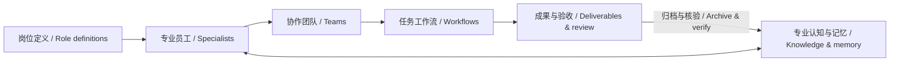

<a id="top"></a>

# DSH_Graph-Horses

Composable Digital Workforce for DeepSeek Harness · 可组装的专属数字员工团队

**在同一个平台 DeepSeek Harness（DSH）中，打造属于你所在行业的专属 AI 员工、团队与工作流，让每个岗位拥有自己的专业能力、认知与记忆。**

**Build the AI employees, teams, and workflows your industry needs—all within DeepSeek Harness (DSH), with role-specific capabilities, professional knowledge, and memory.**

从一个岗位，到一支分工协作的团队，再到可执行、可验收的工作流。自带软件开发专业团队，也支持你围绕 AI 视频制作、内容策划、研究分析等场景，自定义岗位、组织能力与专业知识，让不同员工各司其职，在同一平台完成任务与交付。

Start with one specialist, assemble a team, and turn its responsibilities into a workflow with clear deliverables and review criteria. A software development team is included; you can also configure teams for AI video production, content planning, research, and other domains using the models and tools available in your DSH environment.

[简体中文](#zh) · [English](#en) · [安装 / Installation](#zh-install) · [使用 / Usage](#zh-usage) · [English quick start](#en-install)

[下载插件 / Download plugin](https://github.com/TigerHour/DSH_Graph-Horses/releases/download/v0.30.0/dsh-plugin-composable-workforce-0.30.0.tgz) · [SHA-256](https://github.com/TigerHour/DSH_Graph-Horses/releases/download/v0.30.0/dsh-plugin-composable-workforce-0.30.0.tgz.sha256) · [版本说明 / Release notes](https://github.com/TigerHour/DSH_Graph-Horses/releases/tag/v0.30.0)

> 下载 `.tgz` 安装插件；GitHub 的 Source code ZIP 是开发源码。当前版本为带已知限制的预发布。
> Install the `.tgz` plugin package. GitHub’s Source code ZIP contains development sources. This is a prerelease with documented limitations.
>
> 当前仓库为私有，访问源码和下载发布附件需要仓库授权。The repository is private; source and release downloads require access.



<a id="zh"></a>

## 简体中文

[产品能力](#zh-features) · [内置软件团队](#zh-software) · [安装](#zh-install) · [完整使用流程](#zh-usage) · [认知与记忆](#zh-memory) · [卸载与数据](#zh-uninstall) · [开发与贡献](#zh-development)

<a id="zh-features"></a>

### 一个平台，组织你需要的专业分工

`graph_horses` 是一个独立的 DSH 第三方插件。你可以为员工定义“负责什么、擅长什么、使用什么模型和工具、参考什么专业知识”，将员工组织为团队，再用工作流明确每一步由谁负责、交付什么、如何验收。

| 能力 | 你可以做什么 |
| --- | --- |
| 自定义专业员工 | 设置岗位使命、职责、工作规范与边界；按岗位选择模型、Skill、插件和 MCP 偏好。 |
| 组建协作团队 | 复用已有员工定义，设置团队内名称、上下级关系与职责分工；同一岗位可在不同团队中复用。 |
| 编排工作流 | 为步骤指定负责人、输入、交付物、验收标准和不合格退回目标，形成清晰的任务推进路径。 |
| 在原生对话中工作 | 在 DSH 项目对话选择工作流，当前负责人直接处理你的消息，沿用原生附件、历史、工具与审批。 |
| 积累专业认知与记忆 | 上传资料，浏览概念与实体关系、重组文章和原始证据，分别管理员工私库与团队共享知识。 |
| 跟踪交付与验收 | 查看阶段成果、任务与交付历史；验收后推进，退回后返工，保留原记录与修改依据。 |
| 分享与复用配置 | 使用 JSON 导入、导出员工、团队和工作流定义及必要依赖。 |

#### 例如：打造一支 AI 视频制作团队

你可以根据自己的制作方式配置以下岗位，并为每个岗位补充专业资料与可用工具：

| 岗位示例 | 主要职责 | 专业认知与记忆示例 |
| --- | --- | --- |
| 制片／策划 | 明确受众、主题、风格、周期与交付要求 | 品牌规范、受众资料、已确认的创作要求 |
| 编剧 | 设计叙事结构、脚本、对白与节奏 | 人物设定、世界观、脚本规范与已确认修改 |
| 分镜／视觉设计 | 把脚本转为镜头、画面和视觉要求 | 镜头语言、角色外观、色彩和构图规范 |
| 影像／音频制作 | 使用已接入的工具生成或处理素材 | 模型使用方法、素材规范、已验证的制作经验 |
| 剪辑／交付 | 组织镜头、音频、字幕及输出版本 | 剪辑规范、字幕样式、画幅与输出要求 |
| 质量审核 | 核对叙事、人物、视觉一致性及技术指标 | 审核清单、历史缺陷及验收标准 |

工作流可以是：**创作简报 → 脚本 → 分镜 → 素材制作 → 剪辑 → 质量审核 → 交付**。同样的方法也适用于其他行业：改变岗位、工具、知识和验收条件，即可建立自己的专业协作方式。

这是自定义配置示例。仓库当前预置的是软件开发团队；视频生成、配音、剪辑等模型或服务需要在 DSH 中另行接入。员工的能力取决于实际可用的模型、Skill、插件、MCP 和工具。

<a id="zh-software"></a>

### 开箱提供软件开发专业团队

全新 profile 首次启动时提供六个完整岗位，以及对应团队和一条完整软件工程工作流：

| 岗位 | 主要职责 | 必备 Skill |
| --- | --- | --- |
| 产品负责人 | 需求、范围、优先级、验收与需求覆盖 | `requirements-acceptance` |
| 技术负责人／架构师 | 架构、接口、技术取舍、工作分解与独立审查 | `architecture-design` |
| UX/UI 设计师 | 用户路径、交互状态、视觉与可访问性 | `ux-design-review` |
| 开发人员 | 增量实现、问题定位与回归测试 | `incremental-implementation` |
| 测试负责人 | 功能、边界、性能、回归与质量证据 | `quality-verification` |
| 运维负责人 | 打包、安装升级、运行交接、回滚与卸载验证 | `release-readiness` |

- **软件工程 · 11 步**：需求澄清与验收基线 → 交互与体验设计 → 技术方案与根因分析 → 测试计划与回归基线 → 增量实现与缺陷修复 → 独立代码与契约审查 → 独立功能、性能与体验复测 → 候选版本与运行就绪 → 用户验收与发布决定 → 授权发布与运行核验 → 工程复盘与知识交接。
缺陷复现、根因分析、最小修复、独立审查和回归已融入软件工程流程，不再单独安装“缺陷修复”工作流。

默认组织结构为 **产品负责人（第1级）→ 技术负责人／架构师、UX/UI设计师、测试负责人、运维负责人（第2级）；开发人员为第3级，向技术负责人／架构师汇报**。设计、质量验证与运维运行各自保持专业责任，跨岗位由产品负责人统筹；只有开发人员由技术负责人带领。候选制品准备、用户验收和授权发布分别交付证据，未授权的外部发布不会被当作已完成。组织图初始完整适配窗口，支持滚轮缩放、拖动、放大／缩小和一键适配。

每个岗位包含职责与边界、模型继承、必备／优先技能、工作方法、证据与记忆规范、协作及交付定义；每个步骤包含负责人、输入、产物、验收与退回规则。插件共提供 **22 项内置技能**，覆盖需求、架构、设计、实现、测试、代码审查、发布和工程收尾。详见[软件岗位技能](docs/architecture/software-role-skills.md)。

六个岗位和团队共享库自带有原文引用的专业概念与关系，首次启动即可生成并保存知识图谱，无需额外模型请求；原始资料、B/C快照和阅读内容保存在插件专属目录，重启继续使用。随包图谱是专业参考，不能冒充项目事实、已执行任务或已确认记忆。新增资料仍使用现有增量整理流程。

默认内容可编辑、复用或替换，不包含【演示】工作流、模拟完成记录或伪造的已确认记忆。安装不自动执行业务任务；升级已有 profile 不静默覆盖用户配置，也不自动补入默认对象。

已有安装不会自动覆盖用户定义。要显式更新仍未修改的旧默认团队、软件工程流程，并移除未采用的旧“缺陷修复”，先退出目标Web/Desktop，再从解压包运行：

```sh
node lib/upgrade-software-defaults.js --state /absolute/plugin/state.json --dry-run
node lib/upgrade-software-defaults.js --state /absolute/plugin/state.json --host-stopped
```

工具先备份旧状态并登记归属，在一次事务中更新；完整卸载也会清理这些有归属标记的插件备份，未标记的用户备份保留。定制或已有执行记录的团队／流程会保留并说明跳过。尚未执行、仍保持原始配置的已引入团队会同步新层级和负责人，保留员工ID、配置与会话选择。默认Desktop状态为 `$DSH_HOME/composable-workforce/state.json`（未设`DSH_HOME`时为`~/.dsh`）；Web按其实际插件`statePath`配置确定。

<a id="zh-install"></a>

### 安装与第一次使用

#### 准备条件

| 项目 | 当前范围 |
| --- | --- |
| DSH | 官方 **DeepSeek Harness `0.2.1-rc.3`**；其他版本需要重新验证。 |
| Node.js | 声明范围 `^22.19.0 || >=24`；当前验收使用 `24.21.0`。 |
| 界面 | DSH Web 和官方 macOS Apple Silicon Desktop `0.2.1-rc.3`；插件界面跟随 DSH 的中文／English 设置，业务内容保持原文。 |
| 模型 | 在 DSH 中配置可用模型；员工可继承 DSH 默认值或选择单独的岗位模型。 |
| 安装包 | 维护者提供的 `dsh-plugin-composable-workforce-0.30.0.tgz` 及对应 SHA-256。 |

截至 2026-10-26，官方最新 GitHub 发行标签和 npm `next` 为 `0.2.1-rc.3`，npm `latest` 仍为 `0.2.1-rc.2`。本版本按 rc.3 验证；使用 npm 时可显式安装 `@deepseek-ai/dsh@0.2.1-rc.3`。

正式安装只需要受支持的官方 DSH 和插件 `.tgz`，无需克隆、修改或重建 Harness。先核对归档校验和并停止目标宿主，再使用自己的 `DSH_HOME` 与 profile：

```sh
# 替换为你的 DSH 数据目录、profile 和插件归档绝对路径。
DSH_HOME=/absolute/dsh-home dsh plugin --profile web add \
  /absolute/dsh-plugin-composable-workforce-0.30.0.tgz \
  --config.auto-install-peers=false \
  --config.strict-peer-dependencies=false \
  --ignore-scripts
```

安装或更新后，重新启动目标 Harness，并刷新已打开的页面。版本兼容性以实际官方发行版和同一归档哈希的验收为准；安装命令的包管理参数不代表其他版本已兼容。

**最快体验路径：** 打开左侧 **graph_horses** → 查看内置六岗位与软件开发团 → 在 DSH 中打开一个项目及其原生对话 → 选择 **工作流：软件工程** → 向当前负责人描述任务 → 从顶部 **详情** 查看交付并验收。

安装、更新、数据归属与完整清理说明见[接入与生命周期指南](integration/README.md)。

#### 官方 Desktop 桌面版

DSH 已提供官方 Desktop。请从 [DSH 官网](https://deepseek-harness.github.io/deepseek-harness/)下载。桌面版共用 Web 插件机制，本插件使用同一个 `.tgz`；Web 与 Desktop 各有自己的 profile，安装到 Web 不会自动安装到 Desktop。当前实测范围为 macOS Apple Silicon `0.2.1-rc.3`；Windows 桌面版和其他架构尚未在本项目验收。

首次打开 Desktop 完成原生初始化，然后退出应用。请使用 **Desktop 自带的 dsh 命令**安装到 `desktop` profile；npm 安装的 `dsh` 不允许管理该保留 profile。macOS 安装在 `~/Applications` 时，例如：

```sh
"$HOME/Applications/DeepSeek Harness.app/Contents/Resources/runtime/cli/bin/dsh" \
  plugin --profile desktop add /absolute/dsh-plugin-composable-workforce-0.30.0.tgz \
  --config.auto-install-peers=false --config.strict-peer-dependencies=false --ignore-scripts
```

若装在 `/Applications`，相应替换路径。使用自定义 `DSH_HOME` 时，应用和上述命令必须使用同一数据目录。重新打开 Desktop 后，左侧出现 **graph_horses**。桌面端的保存操作兼容官方 `dsh-app://app` 鉴权代理。普通卸载用同一条 Desktop 命令执行 `plugin --profile desktop remove dsh-plugin-composable-workforce`；完整清理的脚本用法见[Desktop 接入说明](integration/README.md#desktop)。

<a id="zh-usage"></a>

### 从员工到交付：完整使用流程

#### 1. 创建或调整专业员工

在 **graph_horses → 自由职业人库** 中选择已有岗位，或新建一个岗位。这里的“自由职业人”是可复用的员工定义；项目执行时才建立具体员工实例。

| 配置入口 | 使用方法 |
| --- | --- |
| 模型配置 | 跟随 DSH 当前默认模型，或指定岗位的 provider、model 与推理力度。账号和凭据仍由 DSH 管理。 |
| 岗位定义 | 填写岗位使命、职责、工作规范和边界。可使用“AI 智填”生成可编辑草稿，检查后保存。 |
| 能力组合 | 添加必备／优先 Skill、优先插件与优先 MCP。必备 Skill 每份工作单开始时加载；优先 Skill 在任务匹配时按需读取。 |
| 认知记忆 | 上传专业资料，浏览知识关系、文章和原文，管理自动归档设置。 |

“AI 智填”使用当前草稿的姓名和模型，生成结果不会自动保存为正式配置。选中某个插件或 MCP 只表达使用偏好，不会自动安装、连接或授予权限；需要先在 DSH 中准备好相应能力。

#### 2. 组建团队

在 **团队** 中引入已配置的员工，设置团队内名称及上下级关系。员工定义可被多个团队复用，同一岗位也可作为不同成员加入团队。

团队的 **资料管理员** 开关控制团队共享及成员长期知识的使用与整理。共享资料管理员跟随团队唯一负责人的模型；员工私库使用该员工的模型和独立整理提示，不额外占用业务岗位。

#### 3. 定义工作流

在 **工作流** 中新建或编辑流程，先引入团队，再为每一步选择该团队内的负责人。当前编辑器提供步骤说明、交付内容、验收标准和退回目标；输入资料与依赖可写入步骤说明：

- **步骤说明与输入**：这一阶段要解决什么问题、依据什么资料。
- **交付内容**：应产生的文件、结果或说明。
- **验收标准**：如何判断完成，哪些情况需要退回。
- **不合格退回目标**：本步骤或之前的有效步骤。

保存后，顺序与返工路径会在流程图中显示。步骤尝试次数和运行参数保持有界，避免没有结束条件的重试。

员工和团队引入项目时保存独立配置。当前工作流库则是流程定义的来源：编辑通过版本校验同步到项目引用，项目继续独立保存人员绑定、进度与交付历史。涉及已有交付的破坏性修改会被限制；契约变更可能使后续结果需要重新验证。不要把“编辑模板”理解为自动重做已执行任务。

#### 4. 在项目对话中选择工作流

先在 DSH 中打开项目，再打开该项目的原生对话。输入区初始显示 **工作流：无**，菜单首项也是“无”。

首次选择某个工作流时，会创建其项目团队、员工和人员关系，不执行任务。该项目首次非空选择会成为项目默认，并清除之前的空覆盖，让项目对话统一继承；之后在某个对话改选其他工作流或“无”，只改变该对话的选择。同项目、同工作流共享步骤进度与验收记录。

直接输入任务即可由当前步骤负责人接手，无需 `@`。需要单独派工时，可在行首输入 `@`，选择当前项目已启用的员工；输入中间的 `@` 继续使用 DSH 原生引用功能。

顶部步骤条以 **灰色** 表示未完成、**蓝色** 表示当前步骤、**白色** 表示已验收。点击步骤只切换当前步骤与负责人，不会把之前步骤标成完成。正在执行的对话冻结本轮身份；其他空闲对话仍可选择工作流、选择“无”并使用对应负责人。共享步骤与验收在相关执行结束前受保护。原生空白对话的顶部区域在首次发言后显示。

#### 5. 查看成果、验收与返工

点击顶部 **详情**，左侧查看完整步骤和负责人，右侧查看步骤要求、阶段文件、交付记录、任务摘要及验收结果。**工作流 / 项目知识库** 页签支持只读查看当前流程团队的跨阶段知识与来源。

查看其他步骤不会激活它，明确点击 **设为当前** 才会切换。通过当前负责人真实交付的人工验收后，流程才推进；退回需要填写意见，并按配置返回相应步骤。旧交付与验收记录保留，失效结果不再作为本轮有效成果。

选择 **无** 后恢复 DSH 原生对话行为，移除工作流负责人上下文和模型覆盖；它不会清空历史、重置原生最近使用模型，或改写全局模型默认。更多规则见[工作流详情与验收](docs/architecture/project-delivery-review.md)。

<a id="zh-memory"></a>

### 专业认知与记忆如何工作

每位员工可以拥有自己的专业资料和可见记忆，团队也可以形成共享知识。专业认知不只是一段角色提示词，还包含能回到原文核对的资料、知识重组和关系结构。

| 层次 | 内容 | 用途 |
| --- | --- | --- |
| A · 原始资料 | 上传原件、阅读文本、版本、哈希与来源 | 核实原文、精确引用、比较变化与冲突。 |
| B · 知识重组 | 基于来源整理的文章、解释及引用 | 按任务读取专业细节；模型综合保持候选状态。 |
| C · 导航与关系 | 概览、概念／实体及有证据的语义关系 | 定位相关知识，再按需读取 B 或 A。 |

图谱支持搜索、拖动、缩放、关联展开与同屏阅读。连线来自有证据的语义关系，不因两个页面共用来源就虚构关系。员工私库、团队库和不同项目之间保持作用域隔离；共享同一套知识程序不等于共享全部数据。

**资料管理：** 在“专业知识”中上传 PDF、DOCX、UTF-8 文本、Markdown、JSON、CSV、YAML 或日志。单文件最多 **6 MiB**，每次最多 **8 个文件／12 MiB**。原件与提取文本分别保存；扫描 PDF 和图片文字不做隐式 OCR。抽取或整理失败会保留已归档资料，并提供状态与重试。

**四类知识：** 专业知识、任务档案、复盘经验、工作约束。后三类有独立自动归档开关；关闭分类开关停止后续自动收录，已有资料仍可阅读，重新开启不会立即补扫。团队资料管理员总开关关闭时，则停止该团队及成员长期知识的读取、写入和整理，保留数据。

**增量整理：** 来源更新后只处理变更及必要依赖，保留未受影响内容；重复上传或无变化重试不产生新的模型编纂。自动资料按任务稳定阶段合批，首次启动只本地归档。需要编纂时会通过 DSH 模型服务调用模型，可能产生模型费用；打开已有图谱或阅读文章不会因此发起编纂。

业务对话先读取已有知识或待整理资料索引，不等待冷启动编纂。失败、取消先本地归档，不再每次自动调用模型总结；验收成果、明确知识更新、上传资料或手动整理按增量规则处理。知识库可展开查看最近编纂记录、调用数和已报告用量，缺失统计显示为未报告。

### 原生上下文、缓存与用量

岗位规则和必备技能正文以稳定版本提供一次，任务知识使用独立快照；相同定义沿用版本引用。工具和技能继续通过 DSH 原生注册、目录及消息更新机制提供，不另发一份技能目录。选择“无”不新增员工上下文或业务工具；原生目录中可见的技能摘要仍占输入。

缓存是否命中由 DeepSeek 服务端判定；相同的完整前缀有机会复用，换模型、定义/授权变化或原生压缩可能需要重新建立。命中仍占上下文并计输入。交付详情区分未命中输入、缓存读写、输出和服务商报告总量；缺失统计不会被当作零费用。

0.30.0 默认不再附加固定 120,000 的任务累计 token 限制，长对话沿用原生窗口与压缩；步骤、超时和委派边界继续保留。高级配置 `maxTreeTokens: 0` 表示关闭额外限制，正整数为可选的业务运行树累计计量上限，含缓存输入和输出，并非金额预算，也不覆盖独立知识编纂。完整规则、官方依据和复测见[综合修复记录](docs/audits/2026-10-26-runtime-context-remediation.md)。

**事实与候选分开：** 模型提案、临时聊天和未验收产物不会自动变成已确认长期事实。失败复盘保留现象、证据、原因假设、建议与验证步骤；不会自行确认原因、修改 Skill 或执行建议。出现冲突时保留版本、适用条件和来源，自然语言冲突识别仍受模型能力与证据范围限制。

详见[团队知识库](docs/architecture/team-knowledge.md)、[严格增量规则](docs/architecture/incremental-knowledge.md)及[共享 LLM Wiki](docs/architecture/shared-llm-wiki.md)。

### 分享、迁移与配置复用

员工、团队和工作流标题栏提供导入／导出；使用兼容 JSON 格式交换当前对象及必要依赖。导入先更新草稿，检查并保存后才写入，保留当前对象身份；依赖重新映射为新 ID，不覆盖无关对象。

- 格式标识为 `graph_horses`，`formatVersion: 1`，最大 **1 MiB**；JSON 配置文件不是插件安装包。
- 不导出项目路径、私有记忆、凭据、执行日志或项目工作台任务／成果历史；自由文本仍可能包含你填写的信息，分享前应检查。
- Skill、插件、MCP 和工具保存的是引用，接收环境仍需具备实际能力；导入不会自动安装或扩权。
- 兼容的项目实例配置导入默认暂停，不恢复或重放历史任务。

详见[对象设置交换](docs/architecture/object-settings-transfer.md)。

<a id="zh-uninstall"></a>

### 官方扩展边界、数据与卸载

插件不修改 DSH 源码、构建产物、内置插件或安装目录，只使用目标官方版本已有的 Cordis、bundle/profile、公开服务及 UI 插槽。岗位、Skill、知识和员工之间的消息不会扩大权限；执行继续遵循 DSH 原生预设、沙箱与审批。插件是第三方项目，不代表 DeepSeek 官方出品或背书。

默认专属数据位置为：

```text
$DSH_HOME/composable-workforce/state.json
$DSH_HOME/composable-workforce/knowledge/state.json/
```

状态文件保存员工与团队定义、项目实例、记忆、运行及兼容业务记录；知识目录保存资料、原件、版本和派生知识。自定义 `statePath` 会改变对应位置，完整归属清单见[生命周期指南](integration/README.md)。

**保留数据卸载：** 先停止目标宿主，执行官方命令，之后重启并刷新页面。专属配置与数据保留，便于重装恢复。

```sh
DSH_HOME=/absolute/dsh-home dsh plugin --profile web remove \
  dsh-plugin-composable-workforce --config.auto-install-peers=false
```

**插件专属文件与配置清理：** 使用随包脚本先预览，再在目标宿主已停止的条件下执行。请在移除插件前保留该脚本的可用位置；`purge` 会自行调用官方 remove。

```sh
# 指向实际官方 npm 安装和目标数据目录，不是 Harness 源码目录。
export DSH_INSTALLATION_MANIFEST=/official/install/node_modules/@deepseek-ai/dsh/package.json

node /installed/plugin/scripts/plugin.mjs purge \
  --home /absolute/dsh-home --profile web --dry-run

node /installed/plugin/scripts/plugin.mjs purge \
  --home /absolute/dsh-home --profile web --host-stopped
```

清理只处理经归属校验的插件配置、状态、知识、空专属目录及显式指定的自建服务日志。自定义外部状态需要 `--owned-state-path`；本仓库开发服务清理需要按指南指定 `--service-root`。用户项目、已交付成果、共享凭据、其他插件数据及不明文件保留。

**当前未满足项：** 官方 `DSH 0.2.1-rc.3` 没有会话持久记录删除接口，员工创建的专属原生会话历史仍会保留；官方V4还禁止闭轮后替换工具结果，因此空闲卸载时旧记忆工具结果保留，不能声称已从共享历史完全擦除。因此，目前通过的是插件运行能力、专属文件和配置级清理，尚未满足全部插件专属持久记录清除的严格要求；**0.30.0 是带保留项的验收候选，不能标记为无保留合规成品。** 详见[ADR-001](docs/decisions/001-official-plugin-boundary.md)和[版本验收记录](integration/verification-0.30.0.md)。

### 验证状态与已知限制

0.30.0 修复跨对话锁定、额外任务硬预算、知识冷启动和失败自动编纂；新增原生缓存兼容上下文与完整用量展示。正式归档的验证结果及保留项见[0.30.0验收记录](integration/verification-0.30.0.md)。

0.29.2 修复切换原生权限后工作流误锁：普通空闲对话中，官方不唤醒模型的权限通知不再视为任务；运行中、真实排队输入及需交接的保留会话仍保持保护。权限与通知保持原样，不自动调用模型。见[0.29.2 验收记录](integration/verification-0.29.2.md)。

0.29.1 简化回退显示：本步骤返工不画回环线、不占回退轨道，也不显示特殊提示；跨步骤回退继续标记。配置及实际验收返工逻辑保持原样。本次归档复测见[0.29.1 验收记录](integration/verification-0.29.1.md)，下表保留 0.29.0 的完整基础验收。

最近一次代码审计与归档复测基于官方 DSH、独立临时 profile 和固定归档 SHA-256：

| 检查 | 0.29.0 基础验收结果 |
| --- | --- |
| 类型检查与构建 | 通过 |
| 自动化测试 | 领域、知识库、工作流与界面回归；最终统计见版本验收记录 |
| 真实归档安装、移除、重装与清理 | 15 项生命周期检查通过；原生会话持久记录保留项见上文 |
| 跨版本升级 | 官方 alpha.2 / 插件 0.27.0 → rc.3 / 插件 0.29.0，保留自定义岗位定义与库对象 |
| 官方原生界面与对话工作流 | Web 29 项检查通过；macOS Desktop 实机安装、保存、卸载和重装通过 |
| 宿主程序完整性 | 27,607 个程序文件前后总哈希一致 |

界面与业务执行测试使用临时离线模型适配器，不等同于实际供应商的回答质量、费用、延迟或生产容量验收。当前仅实测 macOS arm64、Node `24.21.0` 和指定 DSH 版本；本地 JSON 全量事务仍随历史规模增长。性能负载、原始证据、根因与后续计划见[完整审计报告](docs/audits/2026-10-26-knowledge-team-workflow.md)。

当前资源库界面只保留自由职业人、团队和工作流；工作入口是原生项目对话及顶部详情。项目目标、任务依赖、成果版本与并行调度等旧工作台后端能力和记录仍保留兼容，**旧工作台编辑器并非当前公开页面入口**。

<a id="zh-development"></a>

### 开发与贡献

以下面向插件开发者，普通使用者按上面的 `.tgz` 安装即可。

先在本插件开发环境准备 `package.json` 列明的官方运行时 peer 依赖。现有 `setup` 脚本可从受支持版本的 Harness SDK 源码目录建立开发链接，只写本插件的 `node_modules`，不会构建或修改宿主；它使用 `DSH_SOURCE_PATH`，不是 `DSH_INSTALLATION_MANIFEST`。

```sh
npm ci --legacy-peer-deps
npm --prefix third_party/llm-wiki ci --ignore-scripts

# 可选开发链接方式：已有兼容 SDK 源码目录时使用。
DSH_SOURCE_PATH=/absolute/deepseek-harness-0.2.1-rc.3 npm run setup

npm run typecheck
npm test
npm run build
mkdir -p artifacts
npm pack --pack-destination artifacts
```

若已通过官方 npm 包在本插件环境准备好全部 peer，无需运行 `setup`。启动与生命周期脚本可用 `DSH_INSTALLATION_MANIFEST` 指向实际官方 npm 安装；它不替代本插件自身的 SDK 依赖准备。

| 命令 | 用途 |
| --- | --- |
| `npm start` | 启动本仓库独立开发 profile。 |
| `npm run service:start / service:status / service:stop / service:open` | macOS 开发后台服务管理；其他系统使用独立终端 `npm start`。 |
| `npm run test:lifecycle -- artifacts/dsh-plugin-composable-workforce-0.30.0.tgz` | 在官方 npm 安装和临时 profile 验证真实归档生命周期。 |
| `npm run test:performance` | 本地合成负载下的状态、持久化、知识包与布局测量。 |

发布前需重新生成归档、SHA-256 和绑定该哈希的验收记录；改动随包文件后不能沿用旧归档验收。提交问题时请附版本、复现步骤、预期／实际行为与脱敏日志。新增能力需遵守 [AGENTS.md](AGENTS.md) 的官方扩展、数据归属和清理要求。

```text
src/domain/   员工、团队、配置交换、状态与原子存储
src/harness/  官方服务、Agent、工具、模型及执行接入
src/client/   原生界面插槽、对话工作流与客户端通信
src/ui/       资源库、编辑器、知识阅读与交付详情
src/knowledge/ 资料归档、增量编纂、证据与知识范围
src/workflow/ 顺序流程状态机、验收、返工与恢复
src/work/     兼容项目目标、任务、成果版本及调度服务
skills/       22 项随包技能与软件岗位预设
integration/  官方接入、安装卸载及版本验收记录
```

### 常见问题

- **必须使用内置软件团队吗？** 不需要。它是可编辑的起点，你可以创建适合自己行业的员工、团队和工作流。
- **为什么升级后没有新增六岗位？** 默认对象只为新状态创建，已有 profile 不被静默覆盖或补种；可手动配置或导入经过检查的模板。
- **为什么选择某个 MCP 后仍不能调用？** 选择仅保存偏好，请先在 DSH 中安装、配置并连接实际服务，再检查原生权限。
- **为什么知识库显示待整理或失败？** 资料归档与模型编纂分开；检查负责人／员工模型是否可用、团队资料管理员开关及资料处理状态，再使用重试。
- **移除员工会删除项目历史吗？** 资源库移除会归档并隐藏定义，保留已有项目实例和记录；目前没有一键恢复入口。卸载插件与删除模板也不是同一操作。

### 文档、许可与致谢

[更新记录](CHANGELOG.md) · [术语表](GLOSSARY.md) · [业务架构](docs/architecture/foundation.md) · [工作流编辑](docs/architecture/workflow-editor.md) · [原生能力与 MCP](docs/architecture/native-capabilities.md) · [配置交换](docs/architecture/object-settings-transfer.md)

插件原创代码采用 [MIT License](LICENSE)。共享 LLM Wiki 程序及其对应源码采用 **GPL-3.0**，不受根目录 MIT 声明重新许可；各依赖保留自身许可证。完整范围见 [LICENSES.md](LICENSES.md) 与[第三方声明](integration/THIRD_PARTY_NOTICES.md)。

感谢 [DeepSeek Harness](https://github.com/deepseek-ai/deepseek-harness) 提供插件与 Agent 扩展基础，以及 [nashsu/llm_wiki](https://github.com/nashsu/llm_wiki) 提供本项目知识程序所采用的上游模块。

[↑ 返回顶部](#top) · [English ↓](#en)

---

<a id="en"></a>

## English

[Features](#en-features) · [Included software team](#en-software) · [Installation](#en-install) · [Usage](#en-usage) · [Knowledge & memory](#en-memory) · [Uninstall & data](#en-uninstall) · [Development](#en-development)

<a id="en-features"></a>

### One platform for the specialists your work needs

`graph_horses` is an independent third-party plugin for DSH. Define what each employee is responsible for, which capabilities and models they use, and what professional knowledge they can reference. Assemble employees into teams, then turn responsibilities into workflows with explicit owners, deliverables, and review criteria.

| Capability | What you can do |
| --- | --- |
| Custom specialists | Define missions, duties, working standards, boundaries, models, Skills, and plugin/MCP preferences. |
| Collaborative teams | Reuse employee definitions, name team members, and configure reporting relationships and responsibilities. |
| Workflows | Specify an owner, inputs, outputs, acceptance criteria, and a rejection target for every step. |
| Native project conversations | Select a workflow in DSH and talk directly to its current owner, retaining native attachments, history, tools, and approvals. |
| Professional knowledge and memory | Upload references and inspect concepts, entities, articles, and original evidence in private or shared libraries. |
| Delivery and review | Inspect stage outputs and history, accept deliveries to advance, or return them for rework with an audit trail. |
| Portable configurations | Import and export employee, team, and workflow definitions with their required dependencies as JSON. |

#### Example: configure an AI video production team

| Example role | Responsibility | Example knowledge and memory |
| --- | --- | --- |
| Producer / planner | Audience, concept, style, schedule, and delivery requirements | Brand guidelines, audience research, approved creative briefs |
| Screenwriter | Story structure, scripts, dialogue, and pacing | Character definitions, story world, script standards, approved revisions |
| Storyboard / visual designer | Shots, composition, and visual direction | Camera language, character appearance, color and composition rules |
| Image / audio producer | Generate or process assets with connected tools | Model guides, asset specifications, verified production experience |
| Editor / delivery specialist | Edit shots, sound, subtitles, and output versions | Editing conventions, subtitle styles, aspect ratios and export requirements |
| Quality reviewer | Narrative, character and visual consistency, technical checks | Review checklists, past defects, acceptance criteria |

A workflow might be **brief → script → storyboard → asset production → editing → quality review → delivery**. Other industries use the same configuration model with different roles, capabilities, references, and acceptance criteria.

This is a configuration example. The included preset is the software development team. Video generation, speech, editing models, and external services must be connected separately through DSH; an employee can only use capabilities actually available in its environment.

<a id="en-software"></a>

### A software development team is included

A fresh profile starts with six complete role definitions, a team, and one complete software engineering workflow:

| Role | Focus | Required Skill |
| --- | --- | --- |
| Product owner | Requirements, scope, priorities, acceptance, and coverage | `requirements-acceptance` |
| Technical lead / architect | Architecture, contracts, trade-offs, work breakdown, independent review | `architecture-design` |
| UX/UI designer | User journeys, interaction states, visual design, accessibility | `ux-design-review` |
| Developer | Incremental implementation, debugging, regression tests | `incremental-implementation` |
| QA lead | Functional, boundary, performance, and regression evidence | `quality-verification` |
| Operations lead | Packaging, installation, upgrades, handover, rollback, removal checks | `release-readiness` |

- **Software engineering · 11 steps:** requirements and acceptance baseline → interaction design → architecture and implementation contracts → test and performance planning → incremental implementation → independent code review → functional and performance verification → candidate packaging and release readiness → requirements coverage, user acceptance and release decision → authorized release and operational verification → retrospective and knowledge handover.
Defect reproduction, root-cause analysis, minimal repair, independent review and regression are integrated into the main engineering workflow. No separate defect-repair workflow is installed.

The default hierarchy is **product owner (level1) → technical lead / architect, UX/UI designer, QA lead and operations lead (level2); only the developer is level3, reporting to the technical lead / architect**. The organization chart initially fits the whole tree and supports wheel zoom, dragging, zoom controls and fit reset.

Roles include responsibilities, boundaries, model inheritance, required/preferred Skills, working methods, evidence and memory policies, collaboration, and delivery definitions. Steps include owners, inputs, outputs, acceptance criteria, and rework rules. **22 bundled Skills** cover the engineering lifecycle; see [software role Skills](docs/architecture/software-role-skills.md).

Each role and the shared team library ships with source-backed professional concepts and explicit relationships. First startup persists the graphs without provider calls; plugin-owned sources, B/C snapshots and reading content survive restarts. These references are not fabricated project facts, completed tasks or confirmed memory. Added materials continue through incremental compilation.

You can edit, reuse, or replace these defaults. They contain no demo workflows, simulated completions, or fabricated confirmed memories. Installation does not execute business tasks. Upgrades preserve existing profiles instead of silently replacing definitions or adding new defaults.

Existing installations preserve user definitions. To explicitly update untouched older defaults and remove an unused legacy defect workflow, quit the target Web/Desktop host and run from the extracted package:

```sh
node lib/upgrade-software-defaults.js --state /absolute/plugin/state.json --dry-run
node lib/upgrade-software-defaults.js --state /absolute/plugin/state.json --host-stopped
```

The tool creates an owned backup and commits once. Full plugin cleanup removes these marked plugin backups; unmarked user backups are preserved. Customized or previously executed rosters/workflows are retained with a skip reason. Untouched, unexecuted adopted teams receive the hierarchy and owner updates while keeping employee IDs, configurations and conversation selections. Desktop uses `$DSH_HOME/composable-workforce/state.json` by default (`~/.dsh` if unset); Web uses its configured plugin `statePath`.

<a id="en-install"></a>

### Installation and first run

| Requirement | Current scope |
| --- | --- |
| DSH | Official **DeepSeek Harness `0.2.1-rc.3`**; other versions require separate validation. |
| Node.js | Declared range: `^22.19.0 || >=24`; current acceptance used `24.21.0`. |
| Interface | DSH Web and official macOS Apple Silicon Desktop `0.2.1-rc.3`. UI language follows DSH Chinese/English settings; user content stays in its original language. |
| Models | Configure a working model in DSH. Employees can inherit the default or use an explicit role model. |
| Distribution | The maintainer-provided `dsh-plugin-composable-workforce-0.30.0.tgz` and matching SHA-256 checksum. |

As checked on 2026-10-26, the newest official GitHub tag and npm `next` are `0.2.1-rc.3`; npm `latest` remains `0.2.1-rc.2`. Select `@deepseek-ai/dsh@0.2.1-rc.3` explicitly for this release.

End users need the supported official DSH installation and the plugin `.tgz`. There is no requirement to clone, patch, or rebuild Harness. Verify the checksum, stop the target host, and install into your intended home and profile:

```sh
# Replace the data directory, profile, and absolute archive path.
DSH_HOME=/absolute/dsh-home dsh plugin --profile web add \
  /absolute/dsh-plugin-composable-workforce-0.30.0.tgz \
  --config.auto-install-peers=false \
  --config.strict-peer-dependencies=false \
  --ignore-scripts
```

Restart Harness and refresh open pages after installation or an update. Compatibility is established by testing the exact official release and archive hash; the package-manager flags do not establish compatibility with other versions.

**Fastest path:** open **graph_horses** in the sidebar → inspect the six roles and software team → open a project and its native DSH conversation → select the included **软件工程** workflow → describe the task → inspect and review its delivery through **Details** in the conversation header. Preset names are user-editable business content and are not automatically translated.

See the [installation and lifecycle guide](integration/README.md) for updates, ownership rules, and cleanup details.

#### Official Desktop app

DSH provides an official Desktop app from the [DSH website](https://deepseek-harness.github.io/deepseek-harness/). It shares the Web plugin system and uses the same `.tgz`. Web and Desktop have separate profiles; installing in Web does not install in Desktop. This project validates macOS Apple Silicon Desktop `0.2.1-rc.3`; Windows and other architectures remain untested.

Open Desktop once to initialize it, then quit. Install into `desktop` with **the command bundled inside Desktop**; the npm CLI cannot manage this reserved profile. For a macOS app installed in `~/Applications`:

```sh
"$HOME/Applications/DeepSeek Harness.app/Contents/Resources/runtime/cli/bin/dsh" \
  plugin --profile desktop add /absolute/dsh-plugin-composable-workforce-0.30.0.tgz \
  --config.auto-install-peers=false --config.strict-peer-dependencies=false --ignore-scripts
```

Adjust the path for `/Applications`. If using a custom `DSH_HOME`, launch the app and its command with the same home. Reopen Desktop to see **graph_horses**. Saving supports the official `dsh-app://app` authentication proxy. Remove with the same Desktop command and `plugin --profile desktop remove dsh-plugin-composable-workforce`; see [Desktop integration](integration/README.md#desktop) for full cleanup.

<a id="en-usage"></a>

### From a role to a reviewed delivery

#### 1. Define an employee

Open **graph_horses → Freelancer library** and select an existing role or create one. A library entry is a reusable definition; a project receives its own employee instance when the workflow is selected.

| Setting | How to use it |
| --- | --- |
| Model | Inherit the current DSH default, or choose a provider, model, and reasoning effort. DSH manages accounts and credentials. |
| Role definition | Describe the mission, duties, working standards, and boundaries. AI autofill can produce an editable draft for review and saving. |
| Capabilities | Select required/preferred Skills and preferred plugins or MCP servers. Required Skills load once per work order; preferred Skills load when relevant. |
| Knowledge and memory | Upload references, read their knowledge graph and source evidence, and manage automatic archiving. |

AI autofill uses the current draft name and model; its result is not automatically saved. Selecting a plugin or MCP server records a preference. It does not install, connect, or grant access to that integration—prepare the capability in DSH first.

#### 2. Assemble a team

Add configured employees under **Teams**, assign team-specific names, and define reporting relationships. Employee definitions can be reused across teams, including multiple members based on the same role.

The team **librarian** switch controls shared and member long-term knowledge use and organization. Shared compilation uses the team's unique lead model; a private library uses its employee's model with a separate organization prompt. Neither creates an extra business employee.

#### 3. Design the workflow

Create or edit a workflow, adopt a team, and choose each step's owner from that roster. The editor provides instructions, required outputs, acceptance criteria, and a rejection target at the current or an earlier step; describe input references and dependencies in the instructions. The diagram shows sequence and rework paths. Attempts and runtime settings are bounded.

Employee and team installations retain independent project configurations. In the current version, the workflow library is the definition source: validated edits synchronize to project references, while projects retain their own personnel bindings, progress, and delivery history. Destructive changes involving existing deliveries are restricted; contract changes can require later results to be revalidated. Editing a definition never automatically reruns completed work.

#### 4. Select it in a native project conversation

Open your project in DSH, then open one of its conversations. The input initially displays **Workflow: None**, with **None** first in the menu.

Selecting a workflow creates its project team, employees, and reporting relationships without executing a task. The project's first non-empty selection becomes its default and clears earlier empty overrides so conversations inherit it. Later selections of a different workflow or **None** affect only that conversation. Conversations using the same workflow in the same project share step progress and review records.

Type normally to work with the current step owner; no `@` is needed. For a separate work order, type `@` at the beginning of a message and choose an enabled project employee. An `@` elsewhere retains DSH's native reference behavior.

The header uses **gray** for pending, **blue** for current, and **white** for accepted steps. Selecting a step changes the current step and owner; it does not mark earlier steps complete. An active conversation keeps its owner frozen, while other idle conversations can select a workflow or None and use their corresponding owner. Shared progress and acceptance remain protected during related execution. The native header appears after the first message in an empty conversation.

#### 5. Inspect, accept, or return the delivery

Open **Details** in the header to inspect the full step list, owners, requirements, stage files, deliveries, task summaries, and review history. The **Workflow / Project knowledge** tabs provide read-only access to cross-stage team knowledge and its sources.

Inspecting another step does not activate it; use **Set as current** explicitly. Only human acceptance of an actual owner delivery advances the workflow. Rejection requires feedback and returns to the configured step. Earlier deliveries remain in history, and invalidated results stop counting as current accepted output.

**None** removes the workflow owner context and model override and restores native DSH conversation behavior. It does not erase history, reset the last-used native model, or change the global model default. See [delivery and acceptance](docs/architecture/project-delivery-review.md).

<a id="en-memory"></a>

### Professional knowledge and memory

Employees can maintain their own references and visible memory, while teams build shared knowledge. Professional context includes source-backed information and relationships, alongside role instructions.

| Layer | Content | Purpose |
| --- | --- | --- |
| A · Sources | Original uploads, readable text, versions, hashes, provenance | Verify details, cite exact evidence, compare changes and conflicts. |
| B · Synthesis | Organized articles and explanations with source references | Read relevant professional detail; model synthesis remains a candidate. |
| C · Navigation and relationships | Overviews, concepts, entities, evidenced semantic relationships | Find relevant material, then read B or A as needed. |

Search, pan, zoom, expand related concepts, and read articles and original evidence alongside the graph. Edges represent evidenced semantic relationships; sharing a source does not create a relationship. Private, shared, and project libraries retain their scope boundaries even though they use one shared knowledge program.

**Uploads:** PDF, DOCX, UTF-8 text, Markdown, JSON, CSV, YAML, and logs. Limits are **6 MiB per file**, **8 files / 12 MiB per batch**. Originals and extracted text are stored separately. Scanned PDFs and image text do not receive implicit OCR. Failed extraction or organization preserves archived material with status and retry support.

**Categories:** professional knowledge, task archives, retrospective experience, and working constraints. The last three have independent automatic archive switches. Disabling a category stops future automatic admission while existing knowledge remains readable; reenabling does not immediately backfill. Disabling the team librarian stops shared and member long-term reads, writes, and organization while preserving data.

**Incremental organization:** changes process only affected sources and necessary dependencies, preserving unaffected content. Duplicate uploads or unchanged retries do not generate fresh model compilation. Automatic material is batched at stable task stages; initial startup performs local archiving only. Compilation uses DSH model services and may incur model costs. Browsing existing graphs or articles does not itself trigger compilation.

Business conversations use available knowledge or pending source indexes without waiting for cold-start compilation. Failed and cancelled attempts are archived locally; they no longer trigger paid synthesis every time. Accepted results, explicit knowledge changes, uploads and manual requests retain incremental processing. The knowledge view exposes recent compilation attempts, call counts and reported usage; missing reports remain unknown.

**Evidence and confirmation:** model proposals, temporary chat, and unaccepted artifacts do not automatically become confirmed long-term facts. Retrospectives distinguish observations, evidence, causal hypotheses, recommendations, and verification steps; they do not confirm causes, modify Skills, or execute recommendations on their own. Conflicting versions and sources remain traceable; semantic conflict detection is limited by the supplied evidence and model capabilities.

See [team knowledge](docs/architecture/team-knowledge.md), [incremental processing](docs/architecture/incremental-knowledge.md), and [shared LLM Wiki](docs/architecture/shared-llm-wiki.md).

### Native context, cache reuse, and usage

Stable role rules and required skill bodies are supplied once with content versions; task knowledge has a separate snapshot. Tools and skills use DSH's native registration, catalog and message-update mechanisms, without a second skill catalog. None adds no current employee context or business tools; skill summaries visible in the native catalog still count as input.

DeepSeek decides whether a complete prefix can be reused. Changing models, definitions, authorization or retained history may require rebuilding part of the cache. Cached input still occupies context and is metered. Delivery details distinguish uncached input, cache reads/writes, output and authoritative provider totals; missing usage is never presented as a free call.

Version 0.30.0 removes the additional fixed 120,000 cumulative business-token cutoff by default. Native context capacity and compaction remain DSH-owned, while step/time/delegation protections remain. Advanced configuration `maxTreeTokens: 0` disables the extra cutoff; a positive value opts into a metered business-run-tree limit including cached input and output. It is neither a monetary cap nor a shared knowledge-compilation limit. See the [combined analysis, remediation and verification](docs/audits/2026-10-26-runtime-context-remediation.md).

### Share and reuse configurations

Employee, team, and workflow title bars provide JSON import/export for the current object and its required dependencies. Import updates a draft first; review and save to persist it. The current object's identity stays intact, dependencies receive remapped IDs, and unrelated objects are not overwritten.

- Format: `graph_horses`, `formatVersion: 1`, maximum **1 MiB**. Configuration JSON is separate from the plugin installation archive.
- Exports exclude project paths, private memories, credentials, execution logs, and workbench task/delivery history. Free text may still contain information you entered; inspect it before sharing.
- Skills, plugins, MCP servers, and tools are references. The destination still needs the actual capabilities; import neither installs them nor grants permissions.
- Compatible project-instance imports start paused and do not restore or replay past tasks.

See [configuration exchange](docs/architecture/object-settings-transfer.md).

<a id="en-uninstall"></a>

### Official extension boundary, data, and removal

The plugin uses the supported release's existing Cordis, bundle/profile, public services, and UI slots. It does not modify Harness source, builds, built-in plugins, or installation files. Roles, Skills, knowledge, and employee messages cannot elevate permissions; execution follows native DSH presets, sandboxing, and approval rules. This is a third-party project, without a claim of official DeepSeek authorship or endorsement.

Default plugin-owned data locations:

```text
$DSH_HOME/composable-workforce/state.json
$DSH_HOME/composable-workforce/knowledge/state.json/
```

The state file contains role/team definitions, project instances, memories, runs, and compatible business records. The knowledge directory contains sources, originals, versions, and derived knowledge. A custom `statePath` changes these locations; see the [lifecycle guide](integration/README.md) for the ownership inventory.

**Remove while retaining data:** stop the target host, run the official command, then restart and refresh. Configuration and data remain available for reinstallation.

```sh
DSH_HOME=/absolute/dsh-home dsh plugin --profile web remove \
  dsh-plugin-composable-workforce --config.auto-install-peers=false
```

**Clean plugin-owned files and configuration:** preview first, then execute with the target host stopped. Keep the packaged script accessible before removing the package; `purge` invokes official removal itself.

```sh
# The actual official npm installation, not a Harness source checkout.
export DSH_INSTALLATION_MANIFEST=/official/install/node_modules/@deepseek-ai/dsh/package.json

node /installed/plugin/scripts/plugin.mjs purge \
  --home /absolute/dsh-home --profile web --dry-run

node /installed/plugin/scripts/plugin.mjs purge \
  --home /absolute/dsh-home --profile web --host-stopped
```

Cleanup verifies ownership and removes this plugin's configuration, state, knowledge, empty dedicated parents, and explicitly identified custom service logs. External custom state requires `--owned-state-path`; repository development-service cleanup requires `--service-root` as described in the guide. User projects, delivered files, shared credentials, other plugins' data, and unknown files are preserved.

**Open requirement:** official `DSH 0.2.1-rc.3` has no API for deleting persistent session records. Dedicated native employee-session history remains. Official V4 also forbids tool-result replacements outside an open turn, so idle uninstall retains historical memory-tool results and cannot claim complete erasure from shared history. Runtime, plugin-owned file, and configuration cleanup pass, but removal of every plugin-specific persistent record is still unmet. **Version 0.30.0 is a validation candidate with this exception, not an unqualified compliant release.** See [ADR-001](docs/decisions/001-official-plugin-boundary.md) and the [version acceptance record](integration/verification-0.30.0.md).

### Verification status and limitations

Version 0.30.0 addresses cross-conversation locking, the additional default task-token cutoff, blocking knowledge startup and paid synthesis after failures. It adds native cache-compatible context and explicit usage accounting. See the [0.30.0 archive acceptance record](integration/verification-0.30.0.md) for exact results and remaining exceptions.

Version 0.29.2 fixes workflow controls incorrectly locking after a native permission change. Official non-waking permission notices in ordinary idle conversations no longer count as work. Active turns, real queued input and retained sessions requiring handoff stay protected. Permissions and notices remain intact; no model is started. See the [0.29.2 acceptance record](integration/verification-0.29.2.md).

Version 0.29.1 hides self-return loops, lane allocation and special hints while retaining cross-step returns. Editing and execution rules are unchanged. See the [0.29.1 acceptance record](integration/verification-0.29.1.md) for this archive; the table below retains the full 0.29.0 baseline.

The latest code audit and archive verification used an official release, isolated temporary profiles, and one fixed archive SHA-256:

| Check | 0.29.0 baseline result |
| --- | --- |
| Type checking and build | Passed |
| Automated tests | Domain, knowledge, workflow and UI regressions; exact totals are in the version acceptance record |
| Real archive installation, removal, reinstallation, cleanup | 15 lifecycle checks passed; session-persistence exception above remains |
| Official native UI and conversation workflows | 29 native conversation checks and8new UI/knowledge persistence checks |
| Host program integrity | Identical aggregate hash across 27,607 program files before and after |

UI and execution tests use temporary offline model adapters. They do not establish real provider answer quality, cost, latency, or production capacity. The verified environment is macOS arm64, Node `24.21.0`, and the specified DSH release. Full-file local JSON transactions still grow with history. Loads, evidence, root causes, and follow-up plans are in the [audit report](docs/audits/2026-10-26-knowledge-team-workflow.md).

The current library UI exposes employees, teams, and workflows; work happens through native project conversations and header details. Backend services and records for legacy project goals, task dependencies, deliverable versions, and parallel scheduling remain compatible. **The old workbench editor is not a current public page entry.**

<a id="en-development"></a>

### Development and contributions

This section is for plugin development. End users install the `.tgz` as described above.

Prepare the official runtime peer dependencies declared in `package.json` inside this plugin's development environment. The existing `setup` script can link a compatible Harness SDK source directory into this plugin's `node_modules`; it neither builds nor modifies the host. It uses `DSH_SOURCE_PATH`, not `DSH_INSTALLATION_MANIFEST`.

```sh
npm ci --legacy-peer-deps
npm --prefix third_party/llm-wiki ci --ignore-scripts

# Optional development links when a compatible SDK checkout is already available.
DSH_SOURCE_PATH=/absolute/deepseek-harness-0.2.1-rc.3 npm run setup

npm run typecheck
npm test
npm run build
mkdir -p artifacts
npm pack --pack-destination artifacts
```

Skip `setup` if all peers are already prepared from official npm packages. Launch and lifecycle scripts can use `DSH_INSTALLATION_MANIFEST` to locate an actual official npm installation; this does not prepare the plugin's own SDK dependencies.

| Command | Purpose |
| --- | --- |
| `npm start` | Launch the repository's separate development profile. |
| `npm run service:start / service:status / service:stop / service:open` | Manage the macOS development service; on other systems use `npm start` in a separate terminal. |
| `npm run test:lifecycle -- artifacts/dsh-plugin-composable-workforce-0.30.0.tgz` | Verify the actual archive using an official npm installation and a temporary profile. |
| `npm run test:performance` | Measure local synthetic state, persistence, knowledge-packet, and layout loads. |

Before distribution, generate a new archive, checksum, and acceptance record bound to that hash. Changes to packaged files cannot reuse an older archive's acceptance. Report issues with versions, reproduction steps, expected/actual behavior, and redacted logs. Contributions must follow the public extension, ownership, and cleanup requirements in [AGENTS.md](AGENTS.md).

```text
src/domain/    Employees, teams, configuration exchange, atomic state
src/harness/   Official services, Agent, tools, models, execution
src/client/    Native UI slots, conversation workflows, client transport
src/ui/        Libraries, editors, knowledge reader, delivery details
src/knowledge/ Archiving, incremental synthesis, evidence, scope
src/workflow/  Sequential workflows, review, rework, recovery
src/work/      Compatible project goals, tasks, outputs, scheduling
skills/        22 bundled Skills and software role presets
integration/   Official integration, installation, removal, acceptance
```

### Frequently asked questions

- **Do I have to use the software team?** No. It is an editable starting point. Create employees, teams, and workflows for your own domain.
- **Why did upgrading not add six roles?** Defaults are created only for new state. Existing profiles are neither overwritten nor silently reseeded. Configure roles manually or import reviewed templates.
- **Why does selecting an MCP server not make it callable?** Selection is a preference. Install, configure, and connect the actual service in DSH and check native permissions.
- **Why is knowledge pending or failed?** Archiving and model compilation are separate. Check the lead/employee model, librarian switch, and processing status, then retry.
- **Does removing an employee delete project history?** Library removal archives and hides the definition, retaining existing instances and records; there is currently no one-click restore. Removing a template is separate from uninstalling the plugin.

### Documentation, licenses, and acknowledgments

[Changelog](CHANGELOG.md) · [Glossary](GLOSSARY.md) · [Architecture](docs/architecture/foundation.md) · [Workflow editor](docs/architecture/workflow-editor.md) · [Native capabilities and MCP](docs/architecture/native-capabilities.md) · [Configuration exchange](docs/architecture/object-settings-transfer.md)

Original plugin code is licensed under the [MIT License](LICENSE). The shared LLM Wiki program and its corresponding source are licensed under **GPL-3.0**; the root MIT notice does not relicense them. Dependencies retain their own licenses. See [LICENSES.md](LICENSES.md) and [third-party notices](integration/THIRD_PARTY_NOTICES.md) for the complete scope.

Thanks to [DeepSeek Harness](https://github.com/deepseek-ai/deepseek-harness) for its plugin and Agent extension foundations, and [nashsu/llm_wiki](https://github.com/nashsu/llm_wiki) for the upstream modules used in the shared knowledge program.

[↑ Back to top](#top) · [简体中文](#zh)
