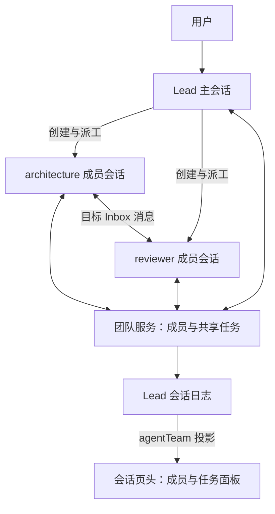

# DSH 内置智能体团队：架构、用法与本项目接入评估

_研究日期：2026-10-18。对象为截图和本机运行的 Harness 0.2.1-alpha.2；依据对应官方标签的文档与本地源码。_

---

## 📋 定位与核查范围

截图中的 `@deepseek-ai/dsh-experimental-agent-team-profile` 是官方随安装提供、默认关闭的实验性组合包。它把团队服务、模型工具和浏览器面板组合起来。当前界面已显示总开关开启、三个组件运行中。团队依托一个 Lead 主会话组织成员，底层复用持续子智能体能力；协作状态可以随会话恢复。[官方组合包说明](https://github.com/deepseek-ai/deepseek-harness/blob/dsh-v0.2.1-alpha.2/packages/experimental/agent-team-profile/README.zh.md)

本次只读核查文档、源码和当前插件详情界面，未发送模型请求、创建团队、切换插件或修改 Harness。此记录不代表本项目已经接入它，也不代表其他版本已完成兼容验证。

## 🏗️ 架构与数据归属

| 截图中的组件 | 包名后缀 | 职责 |
| --- | --- | --- |
| 团队协作 | `experimental-agent-team` | 成员身份、创建/恢复、通信、共享任务与持久化 |
| 团队工具 | `experimental-tool-agent-team` | 把协作服务暴露为模型可调用的九个工具及协作策略 |
| 团队面板 | `experimental-client-ui-agent-team` | 在会话页头展示成员与任务，导航到成员会话 |

组合声明见[官方 bundle 配置](https://github.com/deepseek-ai/deepseek-harness/blob/dsh-v0.2.1-alpha.2/packages/experimental/agent-team-profile/cordis.patch.yml)。这是官方声明式配置扩展，符合本项目允许的机制，不涉及修改宿主源码。



各普通根会话隐式担任自己的 Team Lead，`TeamId` 等于 Lead 的 `SessionId`，不需要先创建独立 Team 对象。teammate 是 Lead 的具名、可继续对话的直接子会话；只有 Lead 能创建或中断成员，成员之间可以直接通信。组织结构为扁平结构，不支持嵌套 Team、重命名、删除或复用成员名称。[身份与服务契约](https://github.com/deepseek-ai/deepseek-harness/blob/dsh-v0.2.1-alpha.2/docs/subsystems/agent-team.zh.md)、[成员实现](https://github.com/deepseek-ai/deepseek-harness/blob/dsh-v0.2.1-alpha.2/packages/experimental/agent-team/src/roster.ts)

成员各自拥有对话历史，所有成员共用 Lead 的工作目录和文件系统。成员表与共享任务的快照追加到 Lead 会话日志，任务和成员管理事件不直接作为模型聊天内容。浏览器读取 `agentTeam` 会话投影，再叠加成员的运行状态和模型信息；面板本身不存团队数据。[团队服务说明](https://github.com/deepseek-ai/deepseek-harness/blob/dsh-v0.2.1-alpha.2/packages/experimental/agent-team/README.zh.md)、[UI 数据来源](https://github.com/deepseek-ai/deepseek-harness/blob/dsh-v0.2.1-alpha.2/packages/experimental/client-ui-agent-team/src/client/mount.ts)

### 上下文与模型

`spawn_teammate` 的参数为 `name`、`description`、`prompt` 和可选的 `context`。`fresh` 是默认值，不继承 Lead 对话；`fork` 在创建时复制 Lead 已完成轮次的历史，不包含当前未完成轮次。初始提示词应写清任务、证据范围和交付要求。[工具源码](https://github.com/deepseek-ai/deepseek-harness/blob/dsh-v0.2.1-alpha.2/packages/experimental/tool-agent-team/src/index.ts)

底层子会话默认继承父会话的模型路由及相关选项；该创建工具没有单成员模型、技能清单、工作目录或工具权限参数。因此命名为 reviewer、architect 等表达的是任务职责，不能据此推导出独立账号、工具权限或文件隔离。[子会话创建逻辑](https://github.com/deepseek-ai/deepseek-harness/blob/dsh-v0.2.1-alpha.2/packages/subagent/subagent/src/child-agent.ts)

### 消息与唤醒

成员通过 `send_message` 向其他成员或 `lead` 发消息。运行中的目标在步骤边界收到引导；未运行目标会启动新轮次，必要时从持久会话恢复。消息投递进目标 Agent 的 Inbox，保留真实发送者身份。成功回执代表收件箱已接受，不代表对方已处理或已完成工作；Team 不额外提供可靠 Outbox、发送重试或重发去重。[消息实现](https://github.com/deepseek-ai/deepseek-harness/blob/dsh-v0.2.1-alpha.2/packages/experimental/agent-team/src/index.ts)、[服务限制](https://github.com/deepseek-ai/deepseek-harness/blob/dsh-v0.2.1-alpha.2/packages/experimental/agent-team/README.zh.md)

`inactive` 仅表示当前没有执行轮次，不能据此判断成功、失败或任务完成。`wait_agent` 等待调用之后的团队变化，不主动唤醒成员；没有其他运行中或准备中的成员时，立即返回 `noProgress`。需先发消息让相关成员继续，再等待并重新检查状态。[协作工具策略](https://github.com/deepseek-ai/deepseek-harness/blob/dsh-v0.2.1-alpha.2/packages/experimental/tool-agent-team/src/index.ts)

### 任务板与调度

共享任务包括状态、负责人、依赖 `blockedBy`、版本 `revision` 和提示性 `writeScopes`。任务依赖必须无环；完成前置任务后，后续任务才可领取。更新携带 `expectedRevision`，过期版本被拒绝。任务状态为 `pending`、`in_progress`、`completed`、`deleted`。[任务服务](https://github.com/deepseek-ai/deepseek-harness/blob/dsh-v0.2.1-alpha.2/packages/experimental/agent-team/src/task-board.ts)

任务就绪、分配负责人都不会自动启动成员；实际派工、唤醒与等待由 Lead/成员调用工具协调。成员停止、中断或失败不会自动释放负责人。`writeScopes` 只生成重叠提示，不提供文件锁或写权限；并行修改仍须分开文件范围，由 Lead 检查最终 diff。[工具策略](https://github.com/deepseek-ai/deepseek-harness/blob/dsh-v0.2.1-alpha.2/packages/experimental/tool-agent-team/src/index.ts)、[任务视图](https://github.com/deepseek-ai/deepseek-harness/blob/dsh-v0.2.1-alpha.2/packages/experimental/agent-team/src/task-view.ts)

## 🚀 实际使用

1. 在插件页开启“智能体团队”；截图中已开启。晚启用后，刷新已打开页面以接收团队投影。
2. 进入目标项目的主会话，在对话中明确要求使用 Agent Teams，并写清成员、任务及完成标准。固定策略要求有明确的团队/teammate 请求才创建成员。
3. 模型创建成员和共享任务。成员通过工具领取、更新任务并互发消息；Lead 等必要成员完成后汇总。
4. 点击具体会话页头的“智能体团队”按钮查看成员与任务。点击成员可打开其持续子会话，也可在成员会话继续提要求。任务板是只读视图，任务修改通过对话与工具完成。

用法依据：[组合包启用](https://github.com/deepseek-ai/deepseek-harness/blob/dsh-v0.2.1-alpha.2/packages/experimental/agent-team-profile/README.zh.md)、[工具触发规则](https://github.com/deepseek-ai/deepseek-harness/blob/dsh-v0.2.1-alpha.2/packages/experimental/tool-agent-team/README.zh.md)、[面板操作与刷新要求](https://github.com/deepseek-ai/deepseek-harness/blob/dsh-v0.2.1-alpha.2/packages/experimental/client-ui-agent-team/README.zh.md)。

可以在本项目主会话发送以下研究任务；它不要求修改文件：

```text
请使用 Agent Teams 研究当前项目，只读，不修改文件，也不修改 DeepSeek Harness。
你担任 Lead，创建两个 fresh teammate：
architecture：梳理项目模块、官方插件接口和宿主依赖。
reviewer：核查 AGENTS.md 中的安装、完全卸载和交付约束。
为两人创建共享任务并写清验收条件，要求完成后更新任务状态，
通过 send_message 向 lead 汇报证据、结论和不确定项。
你须等待两人完成，检查任务板和结论后再汇总。
不要把 inactive 当作完成；需要成员继续时先发消息再等待。
```

后续可对 Lead 说：“请让 reviewer 继续检查卸载后残留的本插件专属资源，完成后更新共享任务并汇报。”这通过对话驱动已有成员继续工作。

### 九个模型工具

| 工具 | 用途 |
| --- | --- |
| `spawn_teammate` | 创建具名成员，仅 Lead |
| `send_message` | 给其他成员发消息，并启动/恢复非活动目标 |
| `list_agents` | 查看成员与当前活动状态 |
| `wait_agent` | 等待下一次团队变化 |
| `interrupt_agent` | 中断成员当前轮次，仅 Lead |
| `team_task_create` | 新建共享任务 |
| `team_task_list` | 浏览或过滤共享任务 |
| `team_task_get` | 读取任务及最新版本 |
| `team_task_update` | 领取、释放、编辑、依赖、完成、重开、重分配、删除 |

工具事实以[真实注册源码](https://github.com/deepseek-ai/deepseek-harness/blob/dsh-v0.2.1-alpha.2/packages/experimental/tool-agent-team/src/index.ts)和[包说明](https://github.com/deepseek-ai/deepseek-harness/blob/dsh-v0.2.1-alpha.2/packages/experimental/tool-agent-team/README.zh.md)为准。工具按 Team 成员身份注册，无额外独立“团队模式”。

## ⚙️ 配置及使用边界

截图对应的官方组合包实际配置为：最多创建 8 个 teammate（失败成员也计数）、最多 256 个未删除任务、单条消息 65,536 字节，关闭清理的分段等待期限为 5,000 毫秒。单独底层服务的成员数默认值为 16，不能与 bundle 覆盖后的 8 混用。[组合包配置](https://github.com/deepseek-ai/deepseek-harness/blob/dsh-v0.2.1-alpha.2/packages/experimental/agent-team-profile/cordis.patch.yml)、[字段含义](https://github.com/deepseek-ai/deepseek-harness/blob/dsh-v0.2.1-alpha.2/packages/experimental/agent-team/README.zh.md)

启用整包会禁用顶层普通 `subagent`/`subagent_fork` 工具及名称重叠的全局子代理控件，改用 Team 创建与控制工具；底层 Subagent 服务继续提供执行能力，Workflow 仍保留 fresh 子代理路径。因此这是子智能体之上的组织与协作层。[官方组合说明](https://github.com/deepseek-ai/deepseek-harness/blob/dsh-v0.2.1-alpha.2/packages/experimental/agent-team-profile/README.zh.md)

使用时须保留以下边界：

- 单进程、共享工作目录；没有本功能提供的 Git worktree、文件锁、合并或远端成员。
- 成员列表扁平，名称永久占用；成员停止后，任务 owner 仍需显式处理。
- 面板提供成员导航和只读任务视图，未提供创建、删除、中断或编辑任务的控件。
- 实验性接口没有稳定性承诺；不同版本需重新验证。

依据：[服务已知限制](https://github.com/deepseek-ai/deepseek-harness/blob/dsh-v0.2.1-alpha.2/packages/experimental/agent-team/README.zh.md)、[UI 已知限制](https://github.com/deepseek-ai/deepseek-harness/blob/dsh-v0.2.1-alpha.2/packages/experimental/client-ui-agent-team/README.zh.md)。

## 🎯 对本项目的意义与待验证事项

以下是基于已确认接口的设计建议，尚未实施，也不构成新架构决策；后续必须遵守 [ADR-001](../decisions/001-official-plugin-boundary.md)。

| 能力 | DSH Agent Teams 已提供 | 本项目仍需负责 |
| --- | --- | --- |
| 执行成员 | Lead 及具名持续子会话 | 长期员工身份、岗位模板、项目实例到运行成员的映射 |
| 协作 | 消息、共享任务、依赖与版本检查 | 业务工作流、交付规则与人工验收 |
| 状态与历史 | Lead 协作日志、成员对话、浏览器投影 | 项目/员工记忆的归属、授权注入和版本 |
| 写入协调 | 提示性写入范围与重叠警告 | 实际工具授权、文件权限及私有记忆边界 |
| 界面 | 会话页头成员与任务面板 | 岗位七模块编辑、模板库、项目员工配置 |

本项目现有岗位、员工、记忆、交付与工作流边界见[基座说明](foundation.md)；当前 `worker_delegate` 和运行状态由本项目 [runtime.ts](../../src/harness/runtime.ts) 管理，尚未复用 TeamService。

建议优先验证用官方 `ctx.agentTeams` 服务及已有会话 UI 扩展点承接协作，减少重复实现成员、消息和任务板。验证前不能把两个 Team 体系直接视为等价，也不能把本项目组织图的层级映射为 Team 的嵌套运行关系。

最小验证范围应包含：使用干净官方发行版；声明所用实验包与兼容版本；建立 employee/run/task/member 的映射；确认创建、完成、取消、恢复及重复派发语义；确认员工模型、工具权限与私有记忆不因 Team 工具注入而扩张；保留人工验收边界；验证卸载清理。优先评估 fresh 加显式授权上下文，fork 的主会话历史需另核验记忆边界。

这些是待完成的接入验证，当前记录不宣称 TeamService 可直接替换现有执行器，也不将源码研究视为运行验收。
