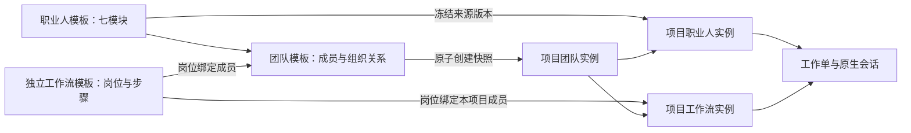

# graph_horses 模板、实例与交换契约

配置交换格式 v1（插件 0.3.0 引入）。员工页面的入口调整不改变七模块数据契约及顺序工作流执行语义。

## 配置关系



职业人模板独立存在，可以被多个团队、同团队多个成员引用。团队成员使用自己的 `memberId`，汇报关系和步骤分工引用成员身份，不把职业人模板 ID 当成员 ID。

独立 `WorkflowTemplate` 定义职责槽位 `roles` 和引用 `roleId` 的步骤，绑定到团队时生成成员流程快照，记录 `sourceTemplateId/sourceTemplateVersion`。修改或删除通用流程不改变已经绑定的团队。旧 `TeamTemplate.workflows` 继续作为成员流程快照使用。

工作流编辑器按步骤仅显示名称、步骤说明、验收标准和负责人，沿用紧凑侧栏与标题操作，不增加维度页签。自由职业人选择用于建立同名流程职责槽位，实际成员在团队／项目引入时映射；同名角色仍按 ID 区分。映射只要求步骤实际引用的角色，未用历史角色及隐藏输入输出、超时和尝试参数完整保留。团队绑定从侧栏弹框操作，详见[工作流编辑](workflow-editor.md)。

若导出时通用流程已更新或删除，无法取得团队所用的确切旧版，则导出冻结步骤并解除该份导出中的来源关联，避免指向另一版本；原团队保持不变。

项目职业人保存来源职业人版本和七模块副本；团队、流程在项目内使用独立 ID。项目流程保存其来源定义，项目内改动不反写通用模板。项目和来源团队的安装记录幂等，取消后明确恢复原实例，不重跑历史任务。

项目工作流当前归属项目团队。直接将独立通用流程引入项目，需要选择项目团队并绑定各岗位；单独导出一个项目流程时携带其团队及成员依赖，导入创建独立团队副本。

## 员工配置入口与模型默认值

员工页提供四个入口：岗位定义、模型配置、能力组合、认知记忆。旧七模块仍属于存储和交换协议；权限沿用 DSH 原生模式，交付与验收放到任务/步骤成果。委派继续检查实际团队关系、显式旧目标限制、深度、并发与预算。能力组合及知识上传见[员工设置改造](employee-settings-refresh.md)。

认知记忆主区只显示概念／实体及有证据的语义关系：同义名称归并为别名，概念与关系均关联 B 文章和精确 A 原文依据，推断关系明确标记。同端点多个有向谓词聚合绘制，孤立概念不按共用文章或来源补线；完整 A/B/C 阅读页面仍在“文章”目录，旧无图快照保留阅读。上方为专业知识、任务档案、复盘经验、工作约束；专业知识提供“上传资料”，其余三类独立切换“开启自动归档”，不作图谱筛选。关闭保留旧 A/B/C，开启不立即调用模型补扫；自动编纂按任务稳定阶段合批。各知识空间的同名分类目录是有效来源的派生索引，移除当前引用仍保留历史原件。这些知识归档、归档开关、概念图谱和派生索引不进入配置交换 JSON；`modules.knowledge` 等既有字段保留兼容，显示和知识快照变更不升级交换格式。

失败反思使用插件任务证据收集、DSH 官方 LLM 服务和专用整理提示生成有依据的复盘提案，不依赖独立 Skill，也不改动原生记忆机制。模型产物不自动成为确认事实或配置变更。

岗位定义使用岗位角色、工作职责、规则边界三个大输入框，仍对应 `responsibilities.mission`、`duties`、`boundaries`。旧职责和边界数组合并展示为多行文本，未编辑时保持原数组；编辑后可将全文保存在一个字符串项中，保留段落和空行，无需升级交换格式。

`model.mode: "inherit"` 表示跟随 DSH 当前默认模型。界面通过官方 `sessionController.modelCatalog().default` 显示默认选中项，执行时从该公开接口读取 provider、model 和可选 reasoningEffort。手选模型保存为 `override`，其配置不被 DSH 默认值覆盖。运行不继承来源会话或项目模型；默认模型不可用时明确失败，不选择目录中的任意首项。既有记录无需批量改写。

此接入复用官方 DSH `0.2.1-alpha.2` 已有 Session Controller，不新增 peer 依赖或服务注入。公开类型与官方实现依据见[模型默认值接入说明](../../integration/architecture-0.2.1.md#2026-10-21-补充当前员工模型选择开发中)；目录读取只返回模型选择所需字段，不包含凭据，不创建会话或发起推理。

## 选择 JSON 的理由

配置是可校验的数据：JSON 能保留七模块、组织关系和步骤引用，浏览器可直接下载/上传，便于比较与版本迁移。技能正文、工具实现不打入配置文件，安装包继续使用官方 npm `.tgz`。

文档结构：

```json
{
  "format": "graph_horses",
  "formatVersion": 1,
  "scope": "template",
  "kind": "team",
  "root": { "id": "源团队 ID" },
  "exportedAt": "ISO-8601 时间",
  "data": {
    "templates": [],
    "teams": [],
    "workflowTemplates": [],
    "employees": [],
    "projectTeams": []
  }
}
```

上面是结构示意；有效文件必须包含 `root.id` 对应的实体及全部引用依赖。

| 字段 | 值 |
| --- | --- |
| `scope` | `template` 通用模板；`project` 项目实例配置 |
| `kind` | `employee` 职业人；`team` 团队；`workflow` 工作流 |
| `root.teamId` | 旧团队内嵌流程或项目流程的归属团队 |
| `templates` | 七模块职业人定义及委派目标的闭合依赖 |
| `teams` | 团队成员、汇报关系及成员流程 |
| `workflowTemplates` | 独立岗位流程及来源定义 |
| `employees` | 去除项目 ID、状态等本机信息的项目职业人快照 |
| `projectTeams` | 去除项目 ID、取消/恢复状态的项目团队快照 |

每个文件选择一个根对象，自动包含所需定义。未知或不完整结构拒绝导入；不接受完整状态数据库备份。项目路径、原生 Workspace ID、记忆、任务、会话和凭据不属于此协议。项目本地文件知识引用和 URL 中的凭据会在导出时排除；自由文本不能保证自动识别所有秘密，分享前需审阅。

## 导入事务

1. 浏览器限制文件最大 1 MiB，读取 JSON 后请求只读预览。服务端再次限制大小、结构深度、节点数、数组数量和支持的版本。
2. 校验七模块、组织层级、流程步骤和所有 ID 引用；拒绝原型污染键、未知结构及悬空引用。
3. 用户确认目标范围；项目目标必须仍是有效原生工作区。模板文件导入模板库，实例文件导入明确项目。跨范围使用“引入通用模板”。
4. 一个原子事务为所有导入定义生成新 ID，重映射成员、上级、委派、流程岗位及来源引用；新副本版本从 1 开始，不覆盖同名或同 ID 对象。
5. 项目职业人统一暂停，保留旧请求权限到 `importReview` 以兼容审计；启用后的新工作单继承 DSH 原生能力与权限，员工页不恢复独立 ACL。导入从不运行工作单。
6. `requestId` 及内容指纹持久化为回执。同一次请求因响应丢失重试，即使页面 revision 已过期也返回原结果，不重复写入；更换内容必须使用新请求 ID。

预览显示对象名称、各类依赖数量和提示。校验失败或版本冲突均不留下部分配置。模板导入保留历史字段，之后实例化按原生 DSH 策略执行；岗位工具偏好不授予额外权限。

## HTTP 接口

复用认证及同源保护下的 `POST /digital-workers/api/command`，正文为 `{action, payload, options?}`；`options.expectedRevision` 采用现有并发控制。

| action | payload |
| --- | --- |
| `workflow.template.save` | `id?`、`expectedVersion?`、`name`、`roles`、`steps`、`maxAttempts?` |
| `workflow.template.delete` | `{id}` |
| `workflow.template.bind` | `{teamId, workflowTemplateId, bindings: {roleId: memberId}}` |
| `bundle.export` | `{scope, kind, id, projectId?, teamId?}` |
| `bundle.preview` | `{document, target: {scope, projectId?}}` |
| `bundle.import` | `{document, target: {scope, projectId?, requestId}}` |

预览和导出不修改状态。导入只提交配置，流程运行继续使用原来的明确发起/人工验收状态机。此版没有增加并行 DAG、条件路由或定时执行。
